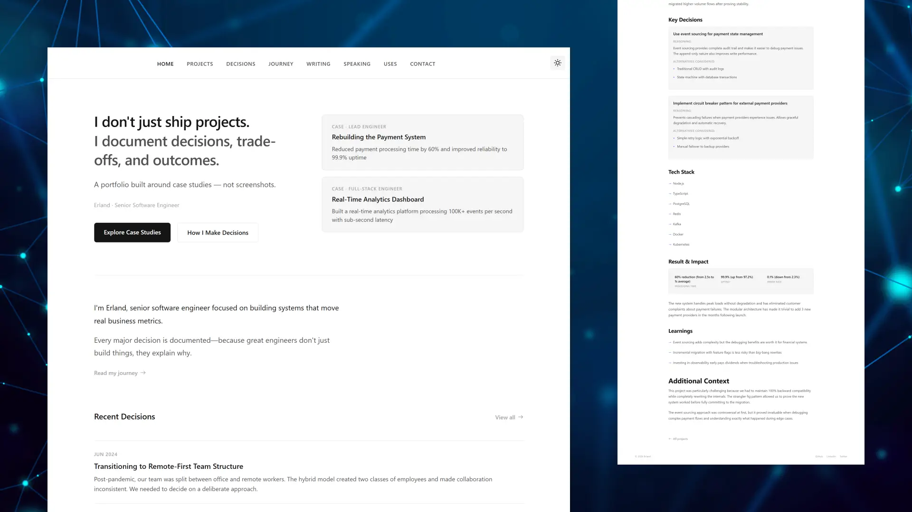
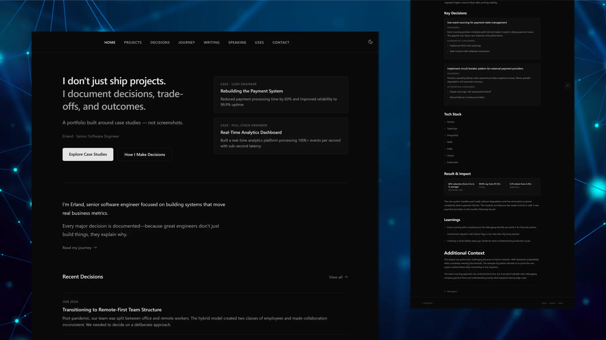

# Udayan Mishra — Portfolio

[](https://astro.build)
[](LICENSE)

Personal portfolio site for **Udayan Mishra**, frontend engineer (Delhi, India — working from Noida). The site is built with **[Case](https://github.com/erlandv/case)**, an Astro theme that treats work as case studies: problem, constraints, decisions, and verified outcomes—not screenshot grids.

**Contact:** [udayanmishra354@gmail.com](mailto:udayanmishra354@gmail.com) · [GitHub](https://github.com/Udman06) · [LinkedIn](https://www.linkedin.com/in/udayan-mishra)

---

## Preview

Static site with light/dark theme. Layout and typography come from Case; copy and case studies are mine and sourced from [`docs/FACTS.md`](docs/FACTS.md).

<div align="center">
  <table>
    <tr>
      <td width="50%">
        
        <p align="center"><em>Light mode — home and featured case snapshots</em></p>
      </td>
      <td width="50%">
        
        <p align="center"><em>Dark mode — same structure, theme toggle</em></p>
      </td>
    </tr>
  </table>
</div>

> **Note:** Screenshots reflect the Case theme shell. After you deploy, replace these with captures of your live site (home, a project page, decisions) for README and OG assets.

---

## What you will find on the site

| Section | Purpose |
|--------|---------|
| **Projects** | Case studies (Admin v3, Spotlyt Marketing, Reelax Ads Web, Spotlyt apps, Reelax Brand v2) |
| **Decisions** | Short ADR-style logs (session handling, legacy routes, video playback, channel connect) |
| **Journey** | Timeline — Honest Digital, Reelax internship, B.Tech |
| **Uses** | Stack and tools used in production work |
| **Contact** | Email and social links |

Writing, speaking, and testimonials collections are empty; those items are omitted from navigation.

---

## Work highlighted in case studies

Facts below are copied from [`docs/FACTS.md`](docs/FACTS.md). Do not publish new metrics in the site or README without updating that file first.

| Work | Role | Highlights |
|------|------|------------|
| **Reelax Admin v3** | Sole engineer | React 19, TanStack Start/Router/Query, Tailwind CSS 4, shadcn/ui · ~17k TS lines · 7 Vitest + 1 Playwright · Auth (roles), dashboard, discovery, orgs, payouts, KYC · many legacy routes still placeholders |
| **Spotlyt Marketing** | Primary frontend | ~83% of current TypeScript, 48 commits · Lighthouse Performance **95+** · pipeline/proxy by teammates |
| **Reelax Ads Web** | Major contributor | My Creators CRM: 21+ commits, 13 modules, 9 endpoints, ~4k-line helper (~91% mine) · Analytics refactor: 20 commits |
| **Spotlyt customer app / Delivery** | Contributor | 43 and 18 commits respectively |
| **Reelax Brand v2** | Contributor (in progress) | WhatsApp Embedded Signup (161-line module), Gmail OAuth, DTO mapping + tests, HTTPS local dev · chat sync & templates **not released** |

**Reelax internship (Bridgeness Technologies):** 15 Jun 2026 – 15 Oct 2026 · six production repos · 220+ commits · 30+ merged PRs.

---

## Tech stack (this repository)

| Layer | Choice |
|-------|--------|
| Framework | [Astro 5](https://astro.build) (SSG) |
| Content | MDX + [Content Collections](https://docs.astro.build/en/guides/content-collections/) (Zod schemas in `src/content.config.ts`) |
| Theme base | [Case](https://github.com/erlandv/case) (MIT) |
| Images | Sharp (Astro assets) |
| SEO | Sitemap integration, per-page metadata in `src/pages.config.ts` |
| Config | Environment variables (`.env` from `.env.example`) — **not committed** |

Production UI work referenced in case studies uses React/Next.js stacks as described in each project file—not embedded as islands in this Astro site.

---

## Local development

**Prerequisites:** Node.js 18+, npm.

```bash
git clone <your-repo-url>
cd udayan-portfolio
npm install
cp .env.example .env
# Edit .env: name, bio, SITE_URL (after deploy), social links
```

Run the dev server (this repo uses background mode in agent docs):

```bash
npm run dev
# or: astro dev --background  (see AGENTS.md)
```

Open [http://localhost:4321](http://localhost:4321) (or the port Vite prints).

| Command | Action |
|---------|--------|
| `npm run dev` | Development server |
| `npm run build` | `astro check` + production build to `dist/` |
| `npm run preview` | Serve `dist/` locally |

Content changes must pass schema validation—if frontmatter is wrong, `npm run build` fails with a clear error.

---

## Project layout (where to edit)

```text
docs/FACTS.md              # Single source of truth for public claims
.env                       # Site identity & SEO (local only, gitignored)
src/config.ts              # Nav links
src/pages.config.ts        # Page titles & intros
src/pages/index.astro      # Home hero & about paragraphs
src/content/projects/      # Case study MDX
src/content/decisions/     # ADR MDX
src/content/journey/       # Timeline MDX
src/content/uses/          # Stack & tools MDX
public/                    # Favicon, web manifest, static assets
```

Copy and voice rules for contributors and AI edits: [`.cursor/rules/portfolio-voice.mdc`](.cursor/rules/portfolio-voice.mdc).

---

## Deployment

1. Set `SITE_URL` in `.env` to your production URL (canonical links, sitemap, Open Graph).
2. Run `npm run build` and deploy the `dist/` folder (Vercel, Netlify, Cloudflare Pages, etc.).
3. Optional: add `public/Udayan_Mishra_Resume.pdf` and link it from nav when ready.

See [`docs/05-deployment/deployment.md`](docs/05-deployment/deployment.md) for platform-specific steps.

---

## Documentation (theme & Astro)

| Topic | Doc |
|-------|-----|
| Install & structure | [`docs/01-getting-started/`](docs/01-getting-started/) |
| Env & navigation | [`docs/02-configuration/configuration.md`](docs/02-configuration/configuration.md) |
| Content schemas | [`docs/03-content/content-guide.md`](docs/03-content/content-guide.md) |
| Styling & components | [`docs/04-customization/`](docs/04-customization/) |
| Deploy checklist | [`docs/05-deployment/post-deployment.md`](docs/05-deployment/post-deployment.md) |

---

## Theme credit & license

This site is derived from **[Case](https://github.com/erlandv/case)** by Erland (MIT). Case remains MIT-licensed; see [LICENSE](LICENSE).

Portfolio **content** (case studies, decisions, copy) is © Udayan Mishra. Do not reuse employer confidential details; [`docs/FACTS.md`](docs/FACTS.md) defines what may be stated publicly.

---

## Roadmap (repo)

- [ ] Production `SITE_URL` and live README demo link
- [ ] Replace theme screenshots with production captures
- [ ] Resume PDF in `public/`
- [ ] Personal projects section (facts already in `FACTS.md`)
- [ ] Verify ADR dates in `src/content/decisions/` against real decision timelines
